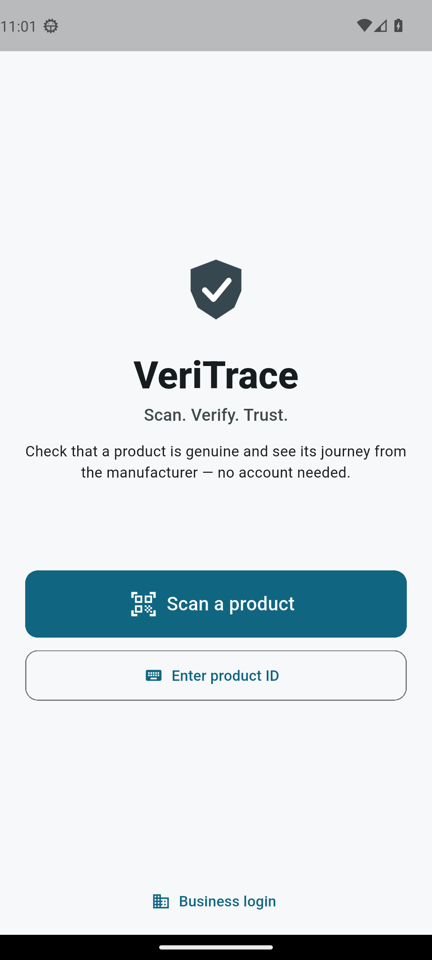
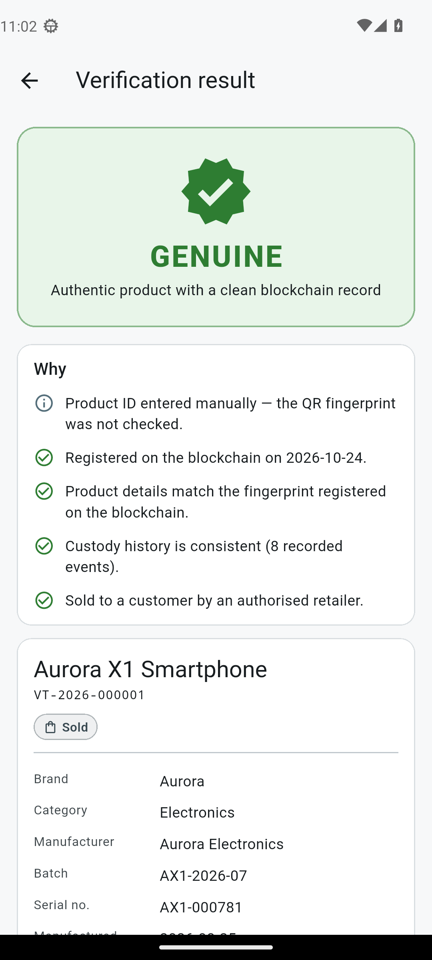
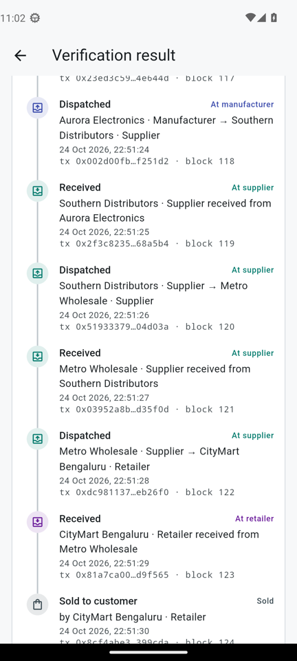
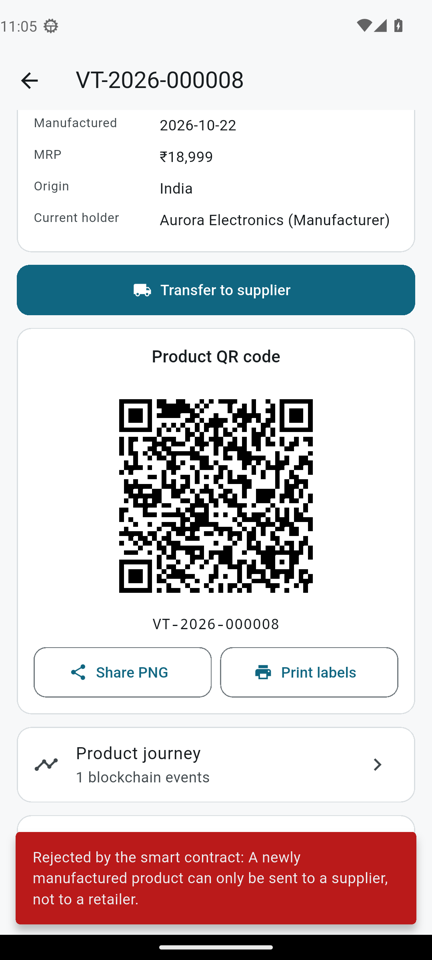
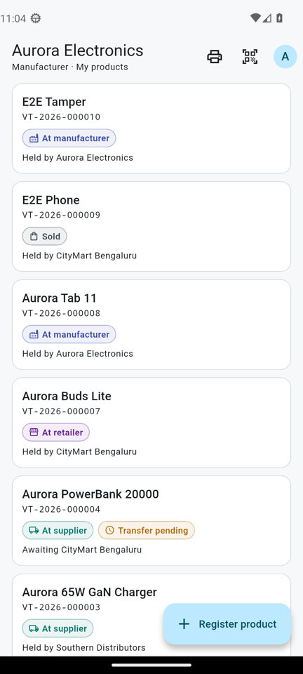
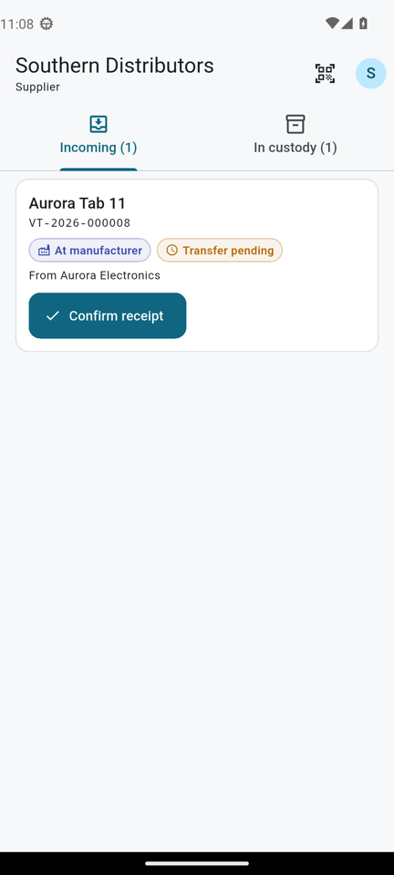
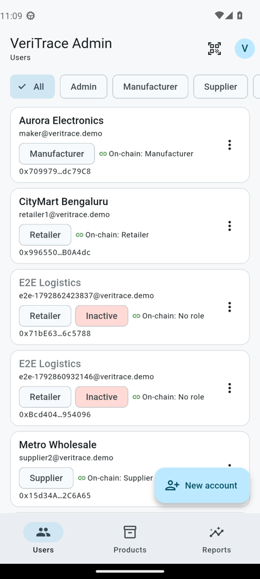
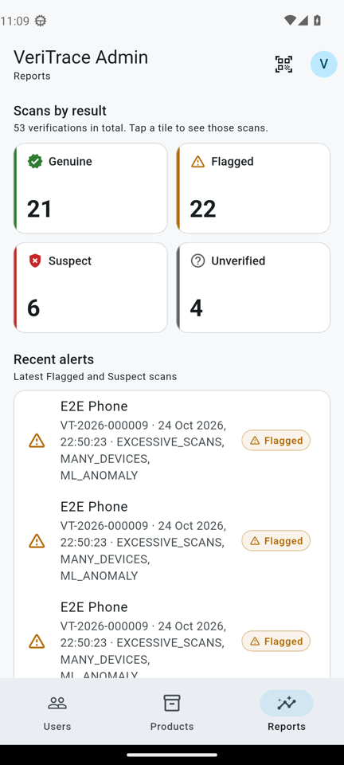

# VeriTrace — *Scan. Verify. Trust.*

Blockchain-backed product authentication prototype (client project **BlockAuth**).
Manufacturers register products on a smart contract. Every custody handoff (manufacturer → suppliers → retailer → sold) is recorded on-chain. Anyone can scan the product's QR code with the Android app to see whether it is **Genuine**, **Flagged**, **Suspect** or **Unverified**, and view its full journey. No account or wallet is needed.

```
Flutter app (Android, Bloc) ──HTTP/JSON──> Node.js + Express ──ethers v6──> BlockAuth.sol (Hardhat)
                                               ├── Firebase Admin (ID tokens, users)
                                               ├── Firestore (users, products, scans, audit)
                                               └── Python ML service (optional anomaly score)
```

## Features
- **Smart contract** `BlockAuth.sol`: roles (Admin/Manufacturer/Supplier/Retailer), two-step custody transfers (initiate → confirm), cancel, mark sold, ordered handoff history, custom errors, events. 25 Hardhat tests.
- **Custodial wallets**: each business user signs with their own HD-derived wallet, so on-chain role checks are real. The app holds no keys.
- **Product fingerprint**: SHA-256 of canonical identity fields, anchored on-chain. Detects forged QR codes and tampered database records.
- **Verification rules** (one module, unit-tested): forged QR / tampered record / inconsistent history → Suspect. Pre-retail scan, pending transfer, expired, over-scanned (possible clone), too-fast handoff, missing metadata, ML anomaly → Flagged. Unknown ID → Unverified.
- **Android app**: public scanner (torch, manual ID), result with journey timeline + technical details; role dashboards for manufacturer (register, QR share PNG, A4 label sheet, transfer), supplier/retailer (incoming, custody, mark sold), admin (accounts, on-chain roles, reports).
- **Demo tooling**: `npm run reset-demo` (redeploy + seed every scenario + QR images), `npm run e2e` (46-check pass/fail table), Postman collection.
- **ML anomaly detection (optional)**: FastAPI IsolationForest trained on synthetic journeys. It scores every verification, shows as a check in "Why" and in Technical details, and admins get an "Anomaly detection (ML)" card in Reports. It can only flag, never mark Suspect, and the app keeps working if it's down.

## ML anomaly detection
`ml/` is a FastAPI service with an IsolationForest model trained on **synthetic** supply-chain journeys (normal journeys plus injected clones, scan bursts, laundering through many hops, scans of unreleased goods, and very old products scanned again).
1. On every verification the backend sends the journey's features (handoffs, min/mean custody gap, age, scan count, distinct devices, scans in the last hour, stage) to `POST /score`, with a 1.5 s timeout.
2. The result is shown in **Why**: *"nothing unusual (score 0.52)"*, or a ⚠ **Flagged** reason when the journey is anomalous. ML can never make a result Suspect.
3. It's also shown in **Technical details** (score, threshold, model), stored with the scan in Firestore (`ml`, `mlScored`), and summarised for admins in **Reports → Anomaly detection (ML)** (online/offline, scans scored, scans flagged, accuracy on synthetic data).
4. If the service is stopped, verification continues: the check reads "not run". The e2e reports the 3 ML checks as SKIP.

Setup, training and metrics: [ml/README.md](ml/README.md).

## Screenshots
| Home | Genuine | Journey | On-chain rejection |
|---|---|---|---|
|  |  |  |  |

| Manufacturer | Supplier | Admin | Reports |
|---|---|---|---|
|  |  |  |  |

## Quick start (Windows)
Prerequisites and Firebase setup: [docs/SETUP.md](docs/SETUP.md). Step-by-step run guide: [docs/RUN_GUIDE.md](docs/RUN_GUIDE.md).

**One command** (phone connected over USB with debugging on) opens every part in its own window:
```powershell
powershell -ExecutionPolicy Bypass -File .\start-all.ps1
```
Or by hand, in separate terminals:
```powershell
npm install; npm --prefix backend install              # 1. install (once)
npx hardhat node --hostname 0.0.0.0                    # 2. T1: local blockchain
npm run reset-demo                                     # 3. T2: deploy contract + seed demo data
npm --prefix backend start                             # 4. T3: backend on :3000
adb reverse tcp:3000 tcp:3000; cd mobile; flutter run --dart-define=API_BASE_URL=http://127.0.0.1:3000   # 5. T4: app (USB)
```
Check: `npm --prefix backend run e2e` → `46/46 passed` (`43/46, 3 skipped` if the ML service is not running).

## Demo accounts (password `Demo@1234`)
| Email | Role | Organisation |
|---|---|---|
| `admin@veritrace.demo` | Admin | VeriTrace Admin |
| `maker@veritrace.demo` | Manufacturer | Aurora Electronics |
| `maker2@veritrace.demo` | Manufacturer | Nila Pharma |
| `supplier1@veritrace.demo` | Supplier | Southern Distributors |
| `supplier2@veritrace.demo` | Supplier | Metro Wholesale |
| `retailer1@veritrace.demo` | Retailer | CityMart Bengaluru |
| `retailer2@veritrace.demo` | Retailer | QuickCare Pharmacy |

Demo QR images (one per scenario, plus a forged and an unknown one) are written to [`demo/qr/`](demo/qr/) by `reset-demo`.

## Tests
| Suite | Command | Count |
|---|---|---|
| Contract (Hardhat + chai) | `npm test` | 25 |
| Backend (jest + supertest) | `npm --prefix backend test` | 83 |
| End-to-end (running stack) | `npm --prefix backend run e2e` | 46 checks (3 ML checks SKIP when ML is off) |
| Flutter (bloc_test, widget, unit) | `cd mobile; flutter analyze; flutter test` | 26, 0 analyzer issues |
| ML (pytest) | `cd ml; .\.venv\Scripts\python -m pytest -q` | 7 |

## Documentation
- [USER_GUIDE.md](docs/USER_GUIDE.md): how each user (consumer, manufacturer, supplier, retailer, admin) uses the app, accounts and passwords, result meanings
- [RUN_GUIDE.md](docs/RUN_GUIDE.md): how to start and use everything, step by step (`start-all.ps1`)
- [SETUP.md](docs/SETUP.md): Windows setup, Firebase, `.env`, terminals, LAN IP, firewall, troubleshooting
- [API.md](docs/API.md): every endpoint, auth, request/response, errors · Postman: [docs/postman/](docs/postman/)
- [ARCHITECTURE.md](docs/ARCHITECTURE.md): system diagram, state machine, verification flow, sequences
- [DEMO_SCRIPT.md](docs/DEMO_SCRIPT.md): 5–7 minute walkthrough
- [DECISIONS.md](docs/DECISIONS.md): design choices and deviations from the client plan
- [LIMITATIONS.md](docs/LIMITATIONS.md): what this prototype does **not** prove
- [PROGRESS.md](docs/PROGRESS.md): build log and acceptance checklist
- [ml/README.md](ml/README.md): anomaly service

## Repository layout
```
contracts/  scripts/  test/        Solidity contract, deploy script, Hardhat tests (root = Hardhat project)
backend/                          Express API: config/ routes/ middleware/ services/ scripts/ tests/
mobile/                           Flutter app (package com.veritrace.app): lib/core, lib/features/<feature>/{data,bloc,view}
ml/                               FastAPI + IsolationForest (optional)
demo/qr/                          generated demo QR images
docs/                             documentation, Postman, screenshots
```
Secrets (`backend/.env`, `backend/serviceAccountKey.json`, `mobile/android/app/google-services.json`) are git-ignored. **No personal data on-chain. No location permission in the app.**
"# VeriTrace" 
