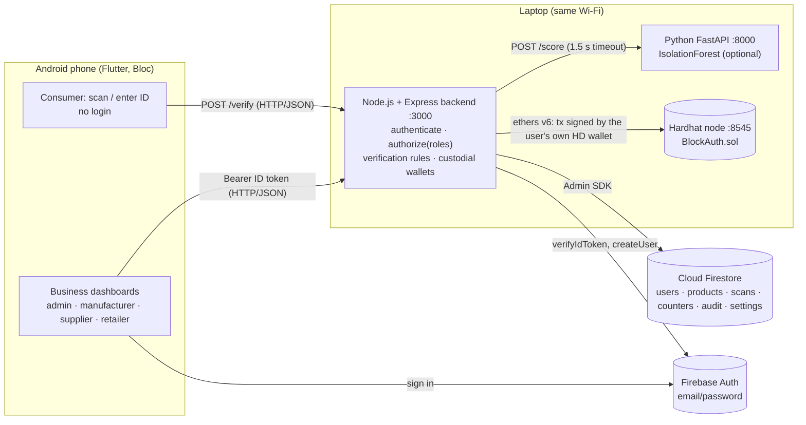
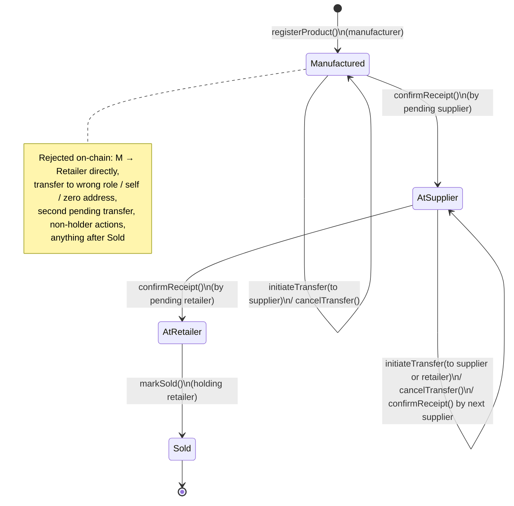
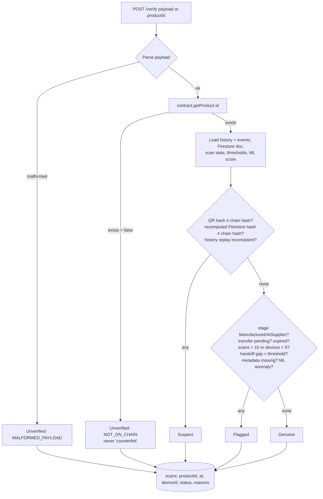
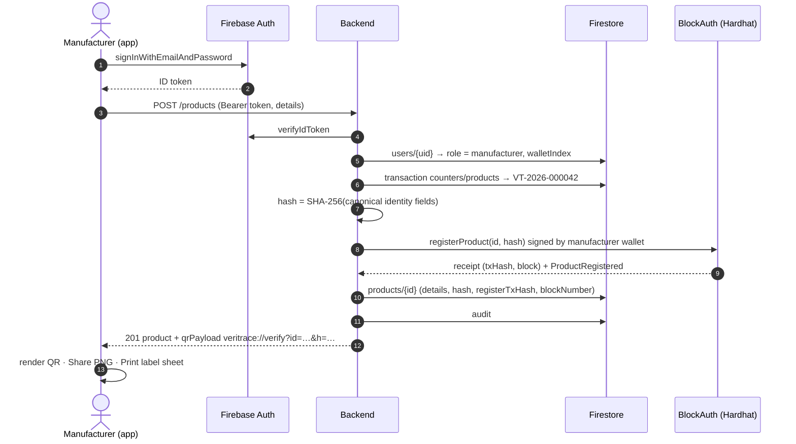
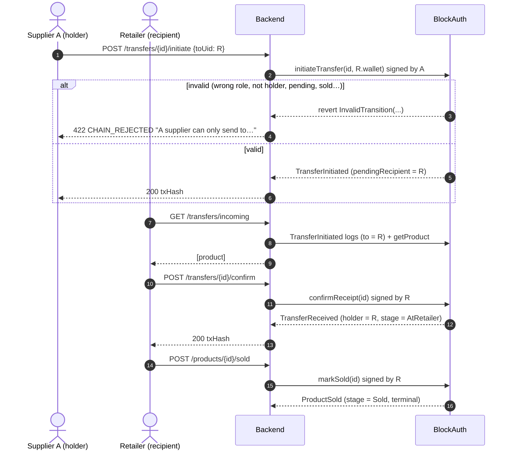

# Architecture

## System

Key points
- The app **never talks to the chain**: no wallet, no keys, no web3 on the phone. Consumers need no account.
- **Custodial wallets**: the backend derives `m/44'/60'/0'/0/<walletIndex>` from its mnemonic and signs every business action with **that user's** wallet, so `msg.sender` role checks in the contract are real. Index 0 = deployer/admin; demo accounts 1–6; new accounts ≥ 10.
- **Roles are enforced twice**: backend `authorize(...roles)` middleware, and the contract (`roles[msg.sender]`, holder/recipient checks, transition rules).
- **On-chain**: product ID key `keccak256(productId)`, SHA-256 fingerprint, custody history. **Off-chain (Firestore)**: product details, user profiles, scans, audit. No personal data on-chain.
- Firestore rules deny all direct client access except reading your own `users/{uid}`; the app goes through the backend.

## Product state machine (enforced by `BlockAuth.sol`)

Every transition appends a `Handoff {from, to, timestamp, eventType, stageAfter}` and emits one event (`ProductRegistered`, `TransferInitiated`, `TransferReceived`, `TransferCancelled`, `ProductSold`). The backend matches the n-th event to the n-th handoff to attach `txHash` + `blockNumber`.

## Verification decision flow (`backend/services/verification.js`)

Implementation: every rule emits a reason with a severity (`critical`, `warning`, `info`, `ok`). The status is the worst severity, so ML (always `warning`) can raise a result to Flagged but never to Suspect.

## Registration sequence

## Transfer sequence (two-step custody)

## Code map

| Area | Path |
|---|---|
| Contract + tests + deploy | `contracts/BlockAuth.sol`, `test/BlockAuth.test.js`, `scripts/deploy.js` |
| API entry | `backend/server.js` |
| Rules (single source of truth) | `backend/services/verification.js`, fingerprint in `backend/services/hashing.js` |
| Chain access, error mapping | `backend/services/blockchain.js`, wallets in `backend/services/wallets.js` |
| Seed / reset / e2e | `backend/scripts/{seed,reset-demo,e2e}.js`, demo data `backend/scripts/demoData.js` |
| App | `mobile/lib/core/*` (API client, router, theme, models), `mobile/lib/features/<feature>/{data,bloc,view}` |
| ML | `ml/{generate_data,train,app}.py` |
